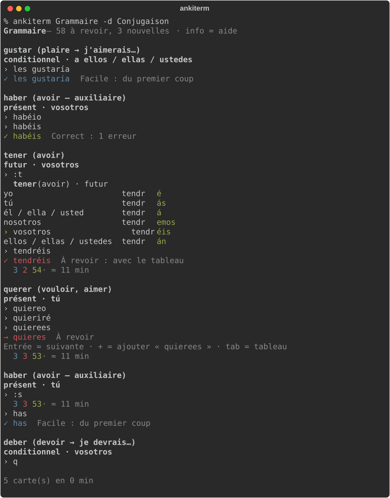

# ankiterm — réviser ses cartes dans le terminal

`ankiterm` révise les paquets d'[Anki Trainer](https://antoine123456.github.io/typeinanki/)
sans quitter le terminal. Il utilise la même progression que l'app : une carte
révisée ici ne revient pas là-bas. Les cartes du jour viennent dans le même
ordre, donc on peut commencer une séance dans le terminal et la finir sur le
téléphone.



## Une séance

On tape la réponse, puis Entrée. On a trois essais : une réponse fausse se
retape, rien n'est barré. Après le troisième essai, la bonne réponse s'affiche
en rouge.

La carte est notée toute seule, avec la même règle que dans l'app. La note et
sa raison s'affichent après le ✓.

| Ce qui s'est passé | Note | ✓ |
|---|---|---|
| Juste du premier coup, sur une carte déjà vue avant aujourd'hui | **Facile** | bleu |
| Juste (une erreur au plus) | **Correct** | vert |
| Trouvé seul mais avec effort : 2 erreurs, ou bien plus lent que d'habitude | **Difficile** | jaune |
| Réponse vue (tableau, `?`, 3 erreurs) | **À revoir** | rouge |

« Plus lent que d'habitude » reprend le réglage ⚙ « trop lent » de l'app, comparé
au temps habituel de chaque carte.

Une carte ratée ne revient pas tout de suite. Elle attend que sa réponse soit
sortie de l'écran, et d'autres cartes passent avant. Après chaque erreur, on voit
ce qui reste : `3 3 53` = nouvelles · à repasser · à réviser, puis le temps
restant estimé.

## Les mots-clés

Tapés à la place d'une réponse, ils ne comptent pas comme un essai. Avec `:`
devant, ils ne peuvent pas être pris pour une réponse ; les mots seuls marchent
aussi.

| Mot-clé | Ce qu'il fait |
|---|---|
| `:t` `tab` | le tableau de conjugaison du verbe et du temps de la carte (Grammaire) ; la carte passera « À revoir » |
| `:s` `:ti` `temps` | les cartes restantes et le temps restant |
| `:h` `:i` `info` | l'aide |
| `:d` `dump` | toutes les cartes restantes, avec leur réponse |
| `?` | la réponse tout de suite |
| `:q` `q` | arrêter (tout est déjà enregistré) |
| Entrée deux fois | la carte à nouveau, si elle est remontée |

**Mon sens était bon** : après une erreur, `+` ajoute la dernière réponse tapée
aux réponses acceptées de la carte, qui compte alors Correct. `+ autre sens`
ajoute ce sens-là. Si c'est trop tard, `+` tapé en premier sur la carte suivante
vaut pour la carte ratée juste avant. Ces sens sont enregistrés dans le cloud,
et l'app les accepte aussi.

## Le défi

`ankiterm --defi verbe` : une minute pour écrire de mémoire le plus possible de
mots espagnols de ce tag (verbe, adjectif, états et émotions…). Chaque mot est
vérifié dans le Vocabulaire et son sens s'affiche ; le record de chaque tag est
gardé, et à la fin les mots les plus fréquents que tu n'as pas cités sont proposés.
`ankiterm --defi` seul affiche la liste des tags.

## Lancer

```sh
ankiterm                          # la liste des paquets
ankiterm Vocabulaire              # un bout du nom du paquet
ankiterm Grammaire -d Conjugaison # seulement les sous-paquets qui contiennent « Conjugaison »
ankiterm Vocabulaire -n 10        # 10 nouvelles cartes (sinon : le réglage ⚙ de l'app)
ankiterm Vocabulaire --dry        # essai : rien n'est enregistré
ankiterm --user                   # choisir à nouveau qui révise
```

Le nombre de nouvelles cartes par jour suit le réglage ⚙ de l'app, synchronisé
d'un appareil à l'autre. Le temps affiché à la fin ne compte que le temps passé
sur les cartes (60 s au plus par carte), pas une séance restée ouverte.

## Installer

Il faut Python 3 ; il n'y a rien d'autre à installer.

```sh
git clone https://github.com/antoine123456/antoine123456.github.io espanol-trainer
cd espanol-trainer
chmod +x trainer.py && ln -sf "$PWD/trainer.py" ~/.local/bin/ankiterm
ankiterm --user                   # la première fois : ton nom d'utilisateur de l'app
```

Les paquets viennent des fichiers du dépôt (`vocabulaire.json`, `grammaire.json`…)
et du cloud pour les tiens. La progression est lue et écrite dans le même
Firestore que l'app.

Le détail technique est dans le [README](../README.md#terminal-trainer-trainerpy).
